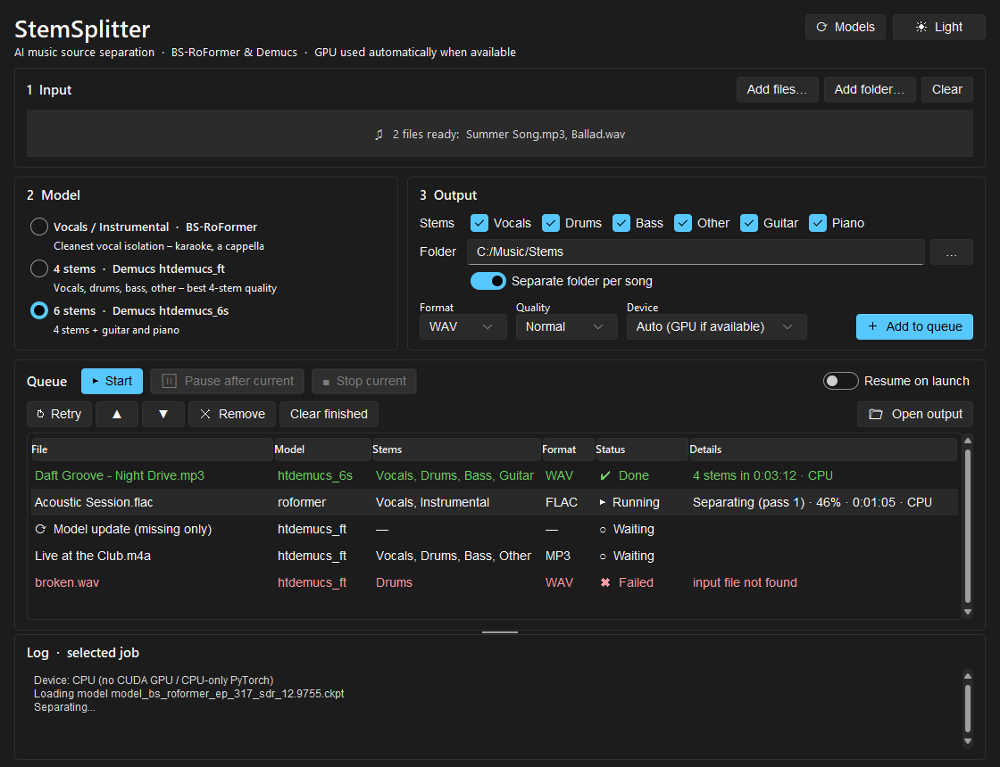

# StemSplitter

A portable Windows app for AI music source separation. Split songs into vocals, drums, bass, guitar,
piano and more using state-of-the-art models. It has a job queue, picks the GPU automatically when one
is available, and has a modern light/dark UI.



## Features
- **Three models to choose from**
  | Model | Stems | Best for |
  |---|---|---|
  | BS-RoFormer (`model_bs_roformer_ep_317_sdr_12.9755`) | vocals, instrumental | cleanest vocals, karaoke, a cappella |
  | Demucs `htdemucs_ft` | vocals, drums, bass, other | best 4-stem quality |
  | Demucs `htdemucs_6s` | + guitar, piano | when guitar/piano matter |
- **Job queue.** Add files or whole folders (drag & drop supported), set the parameters, and let the queue run.
  Each job runs in its own process, so it can be stopped instantly. The queue survives restarts and can
  optionally resume on launch.
- **Automatic GPU use.** If the bundled PyTorch has CUDA *and* a quick test operation succeeds on the card,
  the GPU is used. Otherwise the app falls back to the CPU. The job details show what ran.
- **Choose what to keep.** Pick which stems to save; output is WAV, FLAC or MP3 (320 kbps).
- **Quality presets.** Fast / Normal / Best map to Demucs *shifts* (1/2/5) and RoFormer overlap (2/4/8).
- **Model manager.** See which models are downloaded, pre-download missing ones (e.g. before going
  offline) or re-download them. Updates run as queue jobs; a failed download keeps the old file.
- **Portable.** Models, output, queue and settings all live next to the exe. Copy the folder anywhere.
- **Built-in user guide** in English and Hungarian (**? Help** button):
  [English](https://htmlpreview.github.io/?https://github.com/kirlaca/stem-splitter/blob/main/docs/user_guide_en.html) ·
  [Magyar](https://htmlpreview.github.io/?https://github.com/kirlaca/stem-splitter/blob/main/docs/user_guide_hu.html)

## Download & run
**[⬇ Download StemSplitter v1.0.2 (CPU build, 338 MB)](https://github.com/kirlaca/stem-splitter/releases/download/v1.0.2/StemSplitter-v1.0.2-win64-cpu.zip)**
— or see [all releases](https://github.com/kirlaca/stem-splitter/releases).

Extract the zip anywhere and run `StemSplitter.exe`. No installation or Python needed.
The GPU build is too large for GitHub releases; build it yourself with `build.bat gpu` (see below).

| Build | Size | Runs on |
|---|---|---|
| `StemSplitter` (CPU) | ~0.9 GB | any 64-bit Windows 10/11 PC |
| `StemSplitter-GPU` (CUDA 12.8) | ~5 GB | NVIDIA GPU (GTX 10 series / Pascal or newer, driver ≥ 570); falls back to CPU otherwise |

Models are downloaded on first use into the `models` folder (RoFormer ~640 MB, htdemucs_ft ~340 MB,
htdemucs_6s ~55 MB). After that the app works offline.

> Separation is compute-heavy. On a CPU, a full song takes several minutes per model, and longer at
> *Best* quality.

## Output
With *Separate folder per song* on (default):
```
output/
└── My Song/
    ├── vocals.wav
    ├── drums.wav
    └── ...
```
With it off, files are named `My Song_vocals.wav` etc. in the output folder.

## Run from source
Requires Python 3.10 on Windows.
```bat
py -3.10 -m venv .venv
.venv\Scripts\pip install -r requirements.txt
.venv\Scripts\python stem_splitter.py
```
Use `requirements-gpu.txt` instead for CUDA. ffmpeg is taken from the `imageio-ffmpeg` package automatically.

## Build the portable exe
```bat
build.bat          :: -> dist\StemSplitter\StemSplitter.exe
build.bat gpu      :: -> dist\StemSplitter-GPU\StemSplitter.exe
```
The script creates the virtual environment, installs dependencies, runs PyInstaller and copies ffmpeg
next to the exe. `models`, `output`, `jobs.json` and `settings.json` are preserved across rebuilds.

## Project layout
| File | Purpose |
|---|---|
| `stem_splitter.py` | GUI (tkinter + Sun Valley theme), job queue, model manager |
| `worker.py` | separation / model download, run in a child process per job |
| `build.bat` | portable build (CPU or GPU) |
| `assets/` | app icon (`make_icon.py` regenerates it) |
| `docs/` | user guide (EN/HU, bundled into the exe) and screenshots |

## Credits
- [python-audio-separator](https://github.com/nomadkaraoke/python-audio-separator) – model runner (MIT)
- [Demucs](https://github.com/facebookresearch/demucs) – Hybrid Transformer Demucs models (MIT)
- BS-RoFormer model by viperx, distributed via the UVR model repository
- [Sun Valley ttk theme](https://github.com/rdbende/Sun-Valley-ttk-theme) (MIT),
  [tkinterdnd2](https://github.com/Eliav2/tkinterdnd2) (MIT), [FFmpeg](https://ffmpeg.org/) (LGPL/GPL)

Model weights are not part of this repository; they are downloaded from their original sources and
remain under their respective licenses. Only separate audio you have the rights to use.

## License
[MIT](LICENSE)
